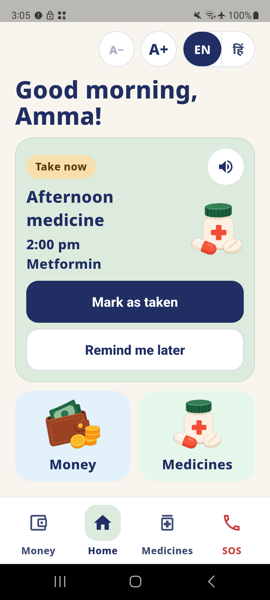
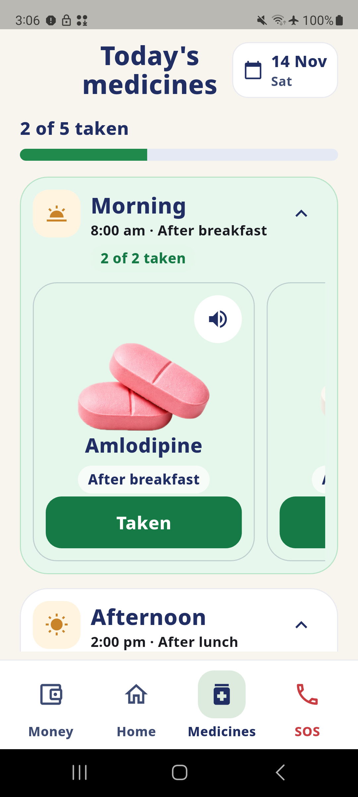
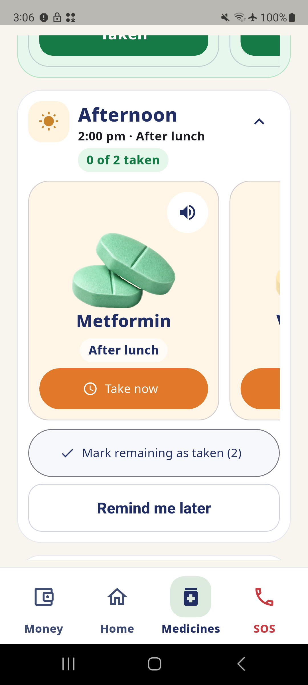
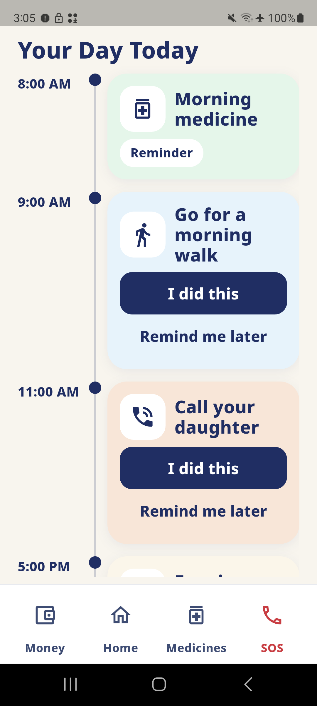
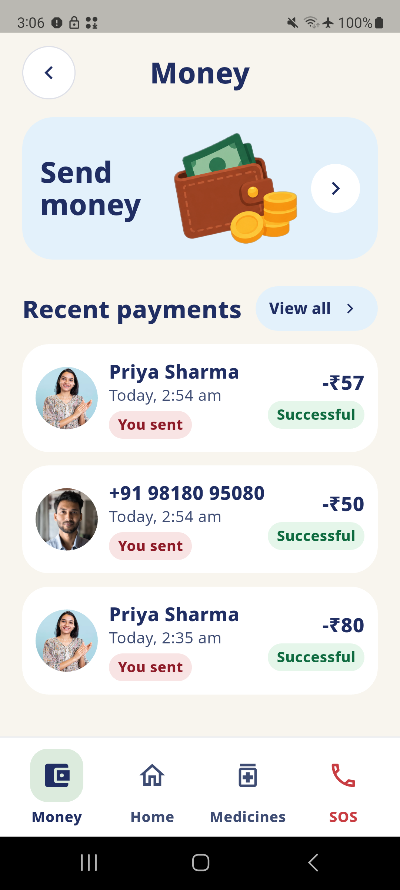
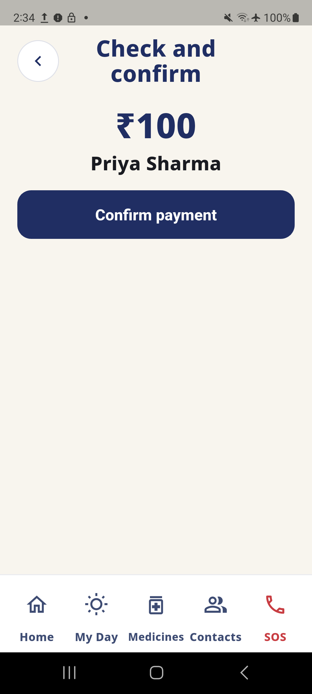
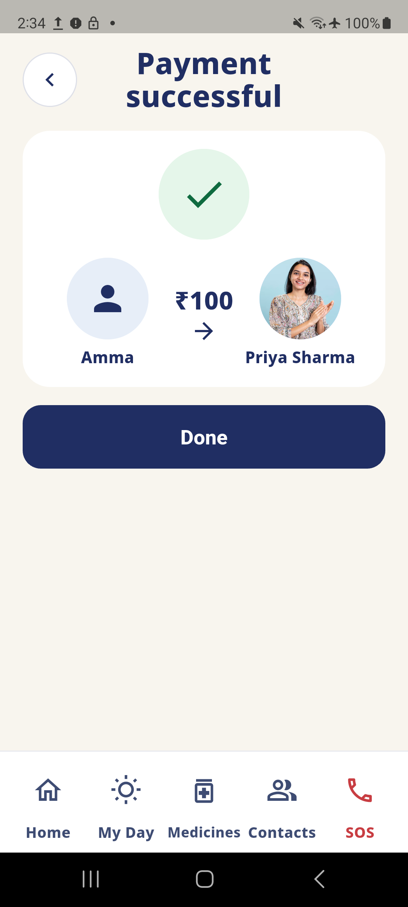
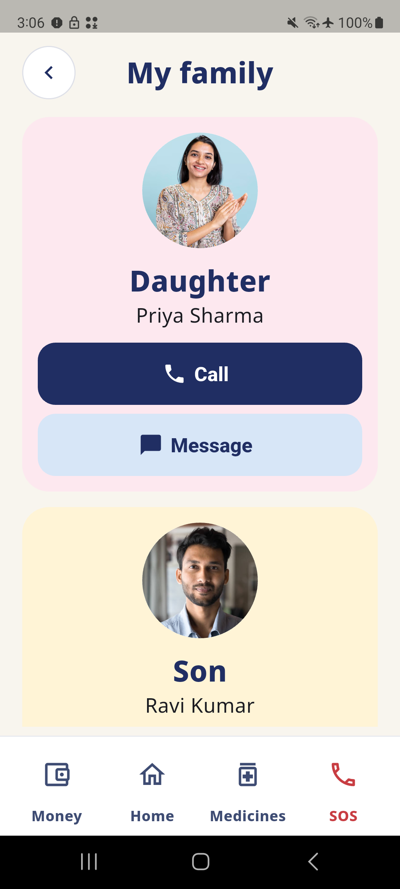
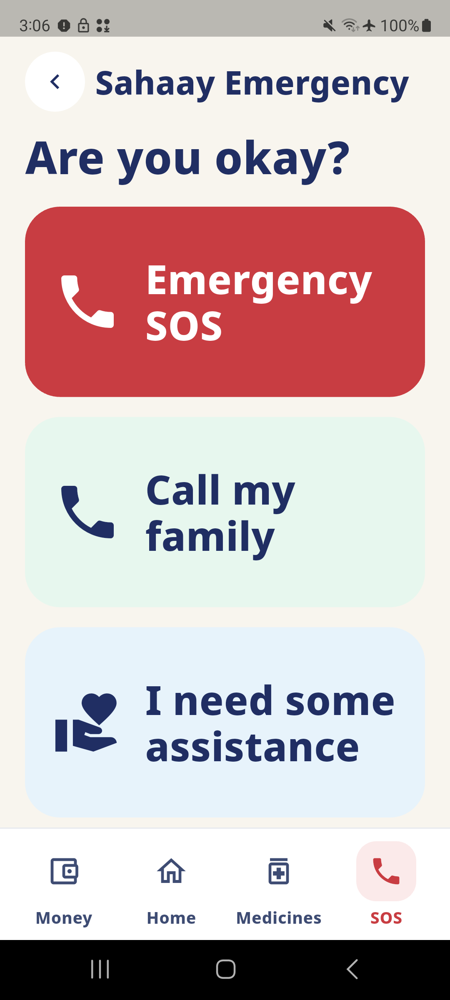
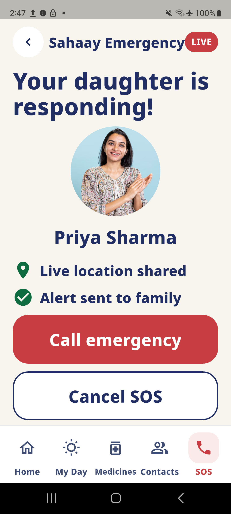

# SAHAAY: A Human–Computer Interaction Case Study of an Elderly-Centred Companion

**A simpler today, a brighter tomorrow**

| | |
|---|---|
| University | [University Name] |
| Department | [Department of Human–Computer Interaction / Design] |
| Programme | [Programme Name] |
| Student | [Student Name] |
| Enrolment number | [Enrolment Number] |
| Faculty guide | [Faculty Guide] |
| Submission | HCI Project Report |
| Date | November 2026 |

---

## Abstract

Older adults often meet the smartphone as a set of separate, densely worded applications: one for medicines, another for payments, another for photographs, and the telephone itself for emergencies. Each interface carries its own language, icon set, and recovery path. SAHAAY is a companion designed around the opposite idea. It gathers the day, medicines, money, family, and emergency help into one calm place, addressed to a person rather than to a task list. This report presents an expert human–computer interaction inspection of the finished interface. It does not report a user study, a survey, or performance statistics. Every claim about the product is grounded in the screens that were examined.

The inspection finds a consistent visual system: a cream ground, navy type, large controls, photographs of named family members, and a four-item bar for Money, Home, Medicines, and SOS. My Day and Family remain prominent destinations on Home, so the bar stays short enough to tap with confidence. Medicines are organised by the rhythm of a day—morning already taken, afternoon ready to take, dinner still ahead—and a single **Take now** action changes an afternoon dose into a green **Taken** state. Money is a guided sequence of person, amount, check, and result, with a hard stop above ₹10,000. My Day joins a timetable, listening, birthdays, and dated family photographs. SOS asks “Are you okay?” and offers three large choices; after Emergency SOS is chosen, the screen later shows the daughter responding, with two remaining actions. The report evaluates these decisions against Nielsen’s heuristics, Fitts’s Law, recognition over recall, cognitive load, and universal design. Strengths include progressive disclosure, redundant cues, and emotional familiarity. Limitations include the absence of participant testing, the demonstration character of payment and calling, and the fact that some reassuring status lines are interface messages rather than confirmed external services. Future work should test the interface with older adults and their families before any claim of clinical or financial effectiveness is made.

**Keywords:** older adults, accessibility, cognitive load, recognition, emergency interaction, inclusive design

---

## Table of Contents

1. Introduction
2. Problem Identification
3. Target Users
4. Design Goals
5. UI/UX Design Principles
6. Detailed Module Analysis
7. User Journeys
8. HCI Evaluation
9. Strengths and Limitations
10. Conclusion and Future Scope
11. References

List of Figures
List of Tables

---

## List of Figures

- Figure 1. Home, with greeting, the current medicine, and picture shortcuts.
- Figure 2. My Day, beginning with a timed list of the day.
- Figure 3. Family, led by relationship and photograph.
- Figure 4. Today’s medicines, with progress and the morning group.
- Figure 5. Afternoon medicines, with Take now and a way to mark the rest.
- Figure 6. Money, with Send money and recent payments.
- Figure 7. Check and confirm, reduced to amount, person, and one action.
- Figure 8. Payment successful, showing who sent, who received, and the amount.
- Figure 9. Sahaay Emergency, with three full-width choices.
- Figure 10. The daughter responding, with status lines and two actions.

Figures are captures of the implemented interface during this inspection. They are illustrations of the design, not results of a user test.

## List of Tables

- Table 1. Designed persona drawn from the sample household in the interface.
- Table 2. Design goals and the interface decisions that serve them.
- Table 3. Journey from Home to an afternoon dose marked taken.
- Table 4. Journey through a guided payment.
- Table 5. Journey through Emergency SOS.
- Table 6. Heuristic inspection summary.
- Table 7. Implemented behaviour distinguished from future scope.

---

## 1. Introduction

### 1.1 Vision

SAHAAY, shown to the person as Sahaay, is an elderly-centred companion. Its line is “A simpler today, a brighter tomorrow.” The name itself is an offer of help. The interface treats the phone as a single, familiar room rather than as a corridor of unrelated applications. A greeting uses the person’s name. A medicine that needs attention sits above the shortcuts. Family members appear as photographs with the relationship written larger than the personal name. An emergency is a question—“Are you okay?”—followed by choices a person can read at a glance.

The vision is independence with company. An older adult should be able to see the shape of the day, confirm a dose, recognise a family member, and ask for help without first learning a new visual language for each job. Dignity is part of that vision. The interface does not speak down. It uses plain verbs, large type, and the person’s own family as the memory cues.

### 1.2 Why an HCI report

Usability, in the sense of ISO 9241-11, is the extent to which specified users can achieve specified goals with effectiveness, efficiency, and satisfaction in a specified context of use (International Organization for Standardization, 2018). For older adults, that context includes changes in vision, dexterity, working memory, and confidence, alongside deep knowledge of people, routines, and household roles (Fisk, Rogers, Charness, Czaja, & Sharit, 2009). A report that only lists features would miss the question this project is built to answer: does the arrangement of words, pictures, colour, and sequence reduce the work of everyday smartphone use?

This document is a design case study. It explains why the interface is organised as it is, walks through the modules a person actually meets, and evaluates them with established HCI principles. It is an expert inspection. No participants were recruited, no tasks were timed, and no satisfaction scores were collected. Where the interface demonstrates a payment, a call, or an alert, the report describes the experience on screen and does not treat that experience as evidence of a completed bank transfer, a connected telephone call, or a delivered emergency dispatch.

### 1.3 Scope of the inspection

The inspection covered the destinations a person can reach from the running interface:

- Home, including text size, language, the priority medicine, and picture shortcuts.
- Medicines, including the day groups, Take now, reminders, and the taken state.
- My Day, including the timetable, listening, birthdays, and throwback photographs.
- Money, including send, the amount keypad, check and confirm, the result, and recent payments.
- Family, reached from Home, including relationship cards, Call, and Message.
- SOS, including the three choices, the activated state, the later response from the daughter, and non-emergency assistance.

The persistent bar contains four items: Money, Home, Medicines, and SOS. My Day and Family are not on that bar. They are reached from Home. That arrangement is described as it is, because a short bar is itself an accessibility decision.

---

## 2. Problem Identification

### 2.1 Fragmented everyday tools

A typical smartphone separates the older adult’s day across products that were not designed as one conversation. A medicine reminder may live in one application, a payment in another, family photographs in a third, and emergency help in the telephone dialler. Each product asks the person to remember where a function lives, what its icon means, and how to recover from a mistake. For someone whose working memory is more easily taxed by unfamiliar steps, that fragmentation is not a minor inconvenience. It is the main barrier between intention and action (Czaja, Boot, Charness, & Rogers, 2019).

The practical problems observed as design motivations, and addressed inside SAHAAY, are these.

**Medicines.** Doses belong to parts of the day, not to a database. People speak of “after breakfast” and “after lunch.” A list sorted only by drug name forces the person to translate medical labels back into the day. Missing the translation can produce either a skipped dose or a second dose. The interface therefore groups medicines as Morning, Afternoon, and Dinner, and it shows one current priority on Home.

**Payments.** General payment applications ask for an identifier, an amount, and a secret code in quick succession, often in small type. The fear of sending money to the wrong person is rational. SAHAAY slows the path: choose how to find the person, see the face and name, enter an amount on a large keypad, then check the amount and the name together before confirming. Amounts above ₹10,000 cannot be completed. The path is a guided practice of that sequence. It is not a bank application, and the inspection does not claim that money moves.

**The shape of a day.** A clock full of notifications does not tell a person what a gentle day looks like. Older adults often want a rhythm: a walk, a call to a daughter, a reminder for medicine, something familiar to listen to. My Day places those items in time order and adds listening, birthdays, and old photographs. The point is orientation and pleasure, not productivity.

**Family.** Contact lists sort by alphabet. Families are remembered by role: daughter, son, sister. A photograph plus the role reduces the need to recall a personal name or a telephone number before acting. SAHAAY’s family cards lead with the relationship.

**Emergencies.** In distress, choice and reading time both shrink. A screen of paragraphs is the wrong shape. SAHAAY opens with one question and three large actions, distinguished by colour. The most urgent action is red and listed first.

### 2.2 The cost of cognitive load

Sweller’s cognitive load theory distinguishes the work demanded by the task itself from the work added by the way information is presented (Sweller, 1988). An older adult who wants to take the afternoon tablet is doing a simple task. If the screen also requires reading a disclaimer, finding a small button, and remembering which application holds the reminder, the extra load is extraneous. SAHAAY’s repeated move is to strip that extra language. Home no longer explains an unconfirmed dose in two languages under the medicine card. The payment check shows the amount and the name, then **Confirm payment**. SOS choices no longer carry a third explanatory sentence. What remains is the decision.

### 2.3 Trust and fear of irreversible action

Two actions feel especially irreversible to many older adults: sending money, and calling for emergency help. Interfaces that hide the consequence until after the tap create anxiety. Interfaces that explain the consequence in a paragraph create delay. SAHAAY uses a middle pattern. Before money is confirmed, the person and the amount are repeated in large type. Before an SOS is cancelled, the interface asks whether help is still needed. After an SOS starts, the screen stays simple and, after a short wait, shows a known face. Trust here is built from repetition, faces, and a small number of exits, not from legal text.

---

## 3. Target Users

### 3.1 Who the interface is for

The intended primary user is an older adult living with family nearby or in regular contact, who uses a phone for a few essential jobs and prefers large type, familiar words, and pictures of people they know. The sample household built into the interface makes that person concrete. The home greeting is “Good morning, Amma!” The family shown are Priya Sharma, identified first as Daughter; Ravi Kumar, identified first as Son; and Anita Desai, identified as Sister in the birthday and memory sections. These are designed sample people. They are not research participants, and nothing in this report is a finding about a real household.

A secondary user is the adult child or sibling who wants to stay informed. Family cards and the SOS response are written toward that relationship. The interface tells the older adult, in plain language, that the family can be kept informed if medicines are missed, and the SOS screen later names the daughter as responding. Those messages shape expectation. They should be read as part of the designed experience, not as proof that a message left the phone.

### 3.2 Persona

Table 1 records the persona implied by the interface. It is a design persona, constructed so that later decisions can be judged against a stable set of needs. It is not a portrait of a recruited user.

**Table 1. Designed persona drawn from the sample household in the interface**

| | |
|---|---|
| Name used in the product | Amma |
| Role | Older adult; the person the interface greets |
| Family in view | Daughter Priya Sharma; son Ravi Kumar; sister Anita Desai |
| Goals | Know which medicine matters now; reach a known person; see the day without clutter; get help quickly if something is wrong |
| Likely constraints | Prefers larger type; may not want to remember which application does which job; may worry about sending money or “doing SOS wrong” |
| What helps | Photographs, relationship words, one primary action per card, colour that means the same thing throughout, English or Hindi for the whole screen |
| What hinders | Paragraphs under every button, alphabetic lists, secret codes in the middle of a payment, more than a few items in the bottom bar |

### 3.3 Needs, goals, and accessibility challenges

The goals visible in the structure of the product are:

1. See, on opening, whether a medicine needs attention.
2. Mark that medicine without hunting through a form.
3. Hear the medicine name and time if reading is tiring.
4. Find daughter, son, or sister by face and role.
5. Move through a payment without losing the amount or the person.
6. Spend part of the day with music, stories, birthdays, and old pictures.
7. Start emergency help with one obvious control, and still be able to cancel it.

Accessibility challenges the interface is built to absorb, following guidance for older adults (Fisk et al., 2009; Czaja et al., 2019), include reduced contrast sensitivity, less precise touch, slower reading, and lower confidence after an error. The responses in the product are large type, 48-pixel minimum controls, a cream page rather than a bright white field, filled buttons for the main action, and an immediate change of state when a dose is marked. Language can be switched between English and Hindi from Home, so a household is not locked to one script.

---

## 4. Design Goals

Table 2 links each goal to decisions that can be seen on the screens.

**Table 2. Design goals and the interface decisions that serve them**

| Goal | What the person should feel | Decision visible in the interface |
|---|---|---|
| Simplicity | “I know what to do next.” | One priority medicine on Home; three SOS choices; payment reduced to check and confirm |
| Accessibility | “I can see it and hit it.” | Large headings, A− / A+ text size, 48-pixel controls, high-contrast navy on cream |
| Independence | “I can do this myself.” | Take now, I did this, Send money, and Emergency SOS are self-serve |
| Trust | “This is my family, and I can undo a scare.” | Photographs, relationship-first names, confirm before cancelling SOS, amount repeated before payment |
| Consistency | “Green means done. Red means urgent.” | Taken is green; Take now is amber; SOS is red; the selected bar item wears a soft highlight |
| Lower cognitive load | “I do not have to remember a code or a path.” | Faces instead of account strings as the main cue; four bar items; no second language under every button |

These goals sometimes compete. A fully explained payment would raise trust for some readers and raise load for others. The implemented check screen chooses load reduction: the amount, the name, and **Confirm payment**. The safety constraint that remains visible earlier in the flow is the refusal of amounts above ₹10,000. That is a concrete error-prevention rule, which Nielsen ranks among the most important heuristics (Nielsen & Molich, 1990).

---

## 5. UI/UX Design Principles

### 5.1 Large typography

Headings on Home and SOS are set very large. Button labels on the main actions are heavy and short. The reason is perceptual and cognitive. Larger type reduces the visual search time for the next action and lowers the chance that a caption is skipped. Text size is not buried in a settings page. On Home, **A−** and **A+** sit at the top, each in a 48-pixel round control, with three steps: default, large, and larger. Putting the control on the first screen means a person can enlarge type at the moment reading becomes hard, which is when the need is felt.

### 5.2 Touch targets

Fitts’s Law states that the time to acquire a target grows as the target gets smaller or farther from the start of the movement (Fitts, 1954). For an older adult, effective target size is smaller than the drawn size because tremor and reduced precision cause misses near the edge. SAHAAY therefore favours a few large targets over many small ones. The bottom bar has four items, so each one is wide. SOS choices expand to fill the screen. **Take now**, **Mark as taken**, **Confirm payment**, **Call emergency**, and **Cancel SOS** are full-width buttons. The text-size and language controls meet a 48-pixel minimum. A short bar is not a missing feature. It is a Fitts decision: wider targets, fewer opportunities to hit the neighbour.

### 5.3 Colour hierarchy

Colour is used as a second channel, never as the only channel. Navy carries ordinary text and the primary button. Cream is the page, easier on ageing eyes than pure white. Soft green marks a completed medicine group and the **Taken** label. Amber marks **Take now**, a state that needs action but is not an emergency. Red is reserved for SOS, for the emergency button, and for the live badge. The selected bar item receives a soft green wash, or a soft red wash on SOS, plus a filled icon. Meaning stays stable: green is settled, amber is now, red is urgent. Consistency of that mapping is what makes colour useful rather than decorative (Norman, 2013).

### 5.4 English and Hindi

Home offers **EN** and **हिं** as a single pill. Choosing one language changes the interface the person is reading: navigation, buttons, and section titles follow the selection. The design rejects a permanent bilingual caption under every control. Two scripts on one button increase line length, shrink the words, and force the eye to decide which line is the command. One language at a time respects both communities in a household and keeps each screen quieter. Hindi support matters because a tool that only speaks English quietly excludes the person it claims to help, or pushes the work onto a younger relative.

### 5.5 Visual recognition

People recognise faces, pill colours, and a few familiar icons more readily than they recall strings of text (Norman, 2013). Daughter, son, and sister are photographs. Medicines are drawn as distinct tablets: pink for Amlodipine, green for Metformin, and further colours for the other doses. Money uses a wallet. Help uses a clear pictorial shortcut. The listening shelf uses a simple symbol for songs, bhajans, stories, news, ghazals, inspiration, and classical music. Recognition is also why the relationship is set in larger type than the personal name. “Daughter” is the category the person is seeking. “Priya Sharma” confirms it.

### 5.6 A consistent bottom bar

The bar is always Money, Home, Medicines, SOS, in that order. Money is at the left edge, SOS at the right edge. Edges are easier to hit than centres, which again follows Fitts’s Law, and the two ends are the two high-stakes tools: money and emergency. Home sits beside Money so return is adjacent. Medicines sits beside SOS so health and help are neighbours. The selected item is filled and lightly highlighted, so the person can answer “where am I?” without reading every label. My Day and Family are intentionally off the bar and on Home. Adding them back would narrow every target. Their pictures on Home still make them recognisable.

### 5.7 Feedback and state

A control that does not change after a tap feels broken, especially when the action is “I have taken this.” Afternoon medicines begin as **Take now**. After the tap, the same card becomes a green **Taken** label and the group count advances. That state change is the feedback. On My Day, “I did this” replaces the buttons with a done mark. On SOS, the title changes from “SOS Activated” to “Your daughter is responding!” and the daughter’s photograph appears. Feedback is visible, local, and in the same place as the action.

---

## 6. Detailed Module Analysis

### 6.1 Home

**Figure 1. Home, with greeting, the current medicine, and picture shortcuts.**

Home is the orientation screen. It opens with a time-of-day greeting and the name Amma, in the largest type on the page. The greeting does social work. It tells the person that the application knows who it is speaking to, which supports trust before any task begins.

Above the greeting, and easy to reach, are **A−**, **A+**, and the language pill. These are personalisation controls, not content. Placing them first means they can be used before the person commits to reading the rest.

The first task card is the priority medicine. In the inspected state it is the afternoon dose: an amber **Take now** badge, the words “Afternoon medicine,” the time, the drug name Metformin, a speaker control, **Mark as taken**, and **Remind me later**. The card is soft green, distinct from the cream page. Priority is an HCI choice. Instead of asking the person to scan five medicines, Home offers the one that currently needs a response. If every dose were already settled, Home would show an “all caught up” state and a path to the full list. The speaker reads the medicine aloud, which supports people who prefer hearing the name and time. It is output, not a voice command. The person does not have to speak to the phone to get through the day.

Under the card, four picture tiles form a grid: Money, Medicines, My Day, and Help. Each tile is a coloured plate, an illustration, and one word. Family is a full-width tile beneath them. Pictures plus a single label support recognition. The grid is the map of the product. A person who never learns the bar can still leave Home by tapping a picture.

The four-item bar remains visible. Home is highlighted. The same bar on every screen is how the product teaches its map: these four places are always one tap away, and Home is always the way back to the pictures.

### 6.2 Medicines

Medicines are treated as a day, not as a cabinet.

**Figure 4. Today’s medicines, with progress and the morning group.**

**Figure 5. Afternoon medicines, with Take now and a way to mark the rest.**

The screen is titled “Today’s medicines,” with the date in a small calendar chip. A count such as “2 of 5 taken” and a progress bar give a sense of the day at a glance. Progress is motivating without being a score. It answers “how much of today is settled?”

Doses are grouped into Morning, Afternoon, and Dinner. Each group shows a clock time and a meal phrase: after breakfast, after lunch, or after dinner. That phrase is how many households already talk about tablets. Matching the interface to that language is recognition over recall. Inside a group, each medicine is a large card: a coloured tablet picture, the drug name, the meal phrase, and a speaker. The picture distinguishes Amlodipine from Aspirin even before the name is read.

The default story of the day is stable, which matters because an older adult may open the screen at any hour. Morning is presented as already taken. Afternoon is presented as **Take now** until the person marks it. Dinner is presented as upcoming, so it does not compete with the dose that is due now. This staging lowers load. The person is not asked to reconstruct the schedule from timestamps.

**Take now** is the action, not a label only. Tapping it marks that dose taken. The card turns green and reads **Taken**, and the group count updates. That was a necessary correction of an earlier state in which the tap was recorded while the card continued to invite the same action. A button that does not change teaches the person that the product is ignoring them. The green replacement is both confirmation and a guard against taking the same tablet again by mistake.

Two further actions sit under the afternoon cards: **Mark remaining as taken**, with the count of what is left, and **Remind me later**. Marking the rest is for the person who has already taken both afternoon tablets and does not want to tap twice. The reminder is the alternative to a false “taken.” Offering both respects honesty. A separate detail view still allows “I’ve taken it” and a change of reminder time. The done screen acknowledges the action with a clear success mark before showing what, if anything, remains.

A speaker on the card supports eyes-busy or low-vision use. Hearing “Metformin, after lunch, 2:00 pm” confirms the object of the tap. Colour, picture, name, time, and sound are redundant cues. Redundancy is a universal-design strategy: the same fact travels by more than one sense (Story, Mueller, & Mace, 1998).

### 6.3 My Day

My Day is the lifestyle and companionship module. It is reached from the Home picture, not from the bar, and it scrolls as one continuous day.

**Figure 2. My Day, beginning with a timed list of the day.**

**Your Day Today** is a vertical timeline. Time sits on the left, a dot marks each event, and a soft card sits on the right. The inspected sequence is a morning medicine reminder at 8:00, a morning walk at 9:00, a call to the daughter at 11:00, an evening stroll at 5:00, and an evening medicine reminder at 8:00. Medicine items are marked as reminders. The walk, the call, and the stroll offer **I did this** and **Remind me later**. Completing an item fills the timeline dot and replaces the buttons with a done state. The timeline is a narrative. It is easier to understand than a grid of unrelated tasks because time itself is the organising principle, and older adults already use time of day as a memory structure.

The actions are deliberately non-punitive. “I did this” is a first-person confirmation, not a checkbox labelled “complete task.” “Remind me later” allows postponement without marking the moment as failed. That wording protects dignity. A day companion that scolds missed walks would be abandoned.

**Listen & Enjoy** follows the timeline. It is a horizontal shelf of large tinted cards: Old Hindi Songs, Devotional Music, Short Stories, Daily News Highlights, Ghazals, Inspirational Stories, and Classic Music. Each card has an icon, a title, and a short line. Tapping plays a simulated piece, with a small player that stays at the bottom so the person can keep scrolling. The content is chosen for familiarity and calm: film songs, bhajans, ghazals, a short story, a simple telling of the news. This is emotional design. A medicine application that only nags will be associated with illness. A day that also offers a song associates the product with ordinary pleasure. For an older adult who spends long periods at home, that companionship is a usability goal, because a tool people enjoy is a tool they return to.

**Moments from Your Family** is the memory layer. It opens with a birthday announcement for Anita Desai, sister, on Sunday 8 November, using her photograph. Upcoming birthdays follow for Ravi Kumar, son, on 18 November, and Priya Sharma, daughter, on 2 December. Throwbacks are full photographs with an event and a date: a family picnic on 2 March 2025, Sunday lunch on 19 January 2025, Diwali at home on 1 November 2024, and dinner at home on 15 August 1998. Opening a photograph shows the event and the date again. Dates turn pictures into autobiography. A picture without a date is decoration. A picture with “Diwali at home, 1 November 2024” is a memory cue and a prompt for conversation. The 1998 dinner extends the life story backward, which matters for a generation whose important photographs are not all recent.

My Day therefore serves three HCI jobs at once. The timeline orients. Listening entertains and regulates mood. Photographs and birthdays sustain relationship. None of these jobs requires the person to assemble a calendar, a music service, and a photo album.

### 6.4 Money

Money is both a bar item and a Home picture, because payment is frequent enough to deserve an edge target and still needs to be discoverable from the picture map.

**Figure 6. Money, with Send money and recent payments.**

The screen has two ideas. **Send money** is a wide, pale-blue card with a wallet illustration and a chevron. Recent payments are rows: a face, a name or a number, the time, “You sent,” the amount, and a green **Successful** chip. Faces in the history mean the person does not have to read every row to find “the one to my daughter.” Status is a word and a colour, not only a symbol.

Sending is a guided sequence.

1. Choose **Scan QR** or **Enter number**, each a large tile with an icon.
2. If scanning, a demonstration scan resolves to a known person. The screen then shows the photograph, the name, and **Continue**.
3. If entering a number, a large keypad collects ten digits, shown in a telephone-sized line, and **Continue** stays quiet until the number is long enough.
4. The amount screen repeats the person’s name, shows the amount in very large type, and offers a large keypad with clear and delete. An amount above ₹10,000 is refused in red: it cannot be completed. **Continue** stays unavailable at zero.
5. **Check and confirm** repeats only the amount and the name, then **Confirm payment** (Figure 7).
6. The result shows **Payment successful**, a tick, the sender, the amount, an arrow, and the recipient’s photograph, then **Done** (Figure 8).

**Figure 7. Check and confirm, reduced to amount, person, and one action.**

**Figure 8. Payment successful, showing who sent, who received, and the amount.**

This sequence is error prevention by structure. The person is identified before the amount, so the amount is never typed into a void. The amount is entered on keys sized for a thumb, with a visible clear. The check screen removes every sentence that is not the decision. Repeating the name beside the amount is a defence against the most costly mistake: paying the right sum to the wrong person. The ceiling at ₹10,000 is a forcing function. It stops a mistyped extra digit from becoming a frighteningly large payment inside this flow.

The result screen uses a transfer metaphor a person already understands: from me, this amount, to that face. **Done** returns to Money. Recent rows keep the episode visible, so the person can recognise what just happened without recalling it.

The inspection treats this as a guided payment experience inside the product. The success layout is reassuring and concrete. It should not be described, in a classroom or to a family, as evidence that a bank transfer occurred. The ethical HCI point is that a realistic success screen creates trust and also creates a duty not to over-claim. Future work, if the product ever moved real money, would need a clearer statement of what has and has not happened. In the interface examined here, that explanatory line has been removed from the success screen in favour of calm. The report therefore records both the design intention (reduce fear and clutter) and the limitation (a realistic confirmation must remain honest).

### 6.5 Contacts and family

Family is the full-width picture on Home, titled as family rather than as an address book.

**Figure 3. Family, led by relationship and photograph.**

Each person is a tall card. The photograph is circular and large. The relationship—“Daughter,” “Son,” “Sister”—is the heading. The personal name sits underneath, smaller. **Call** is a navy button. **Message** is a lighter button of the same size. The order of information is the order of recognition: face, role, name, action. Alphabetical sorting would have forced recall of spelling. Role-first sorting matches the sentence an older adult actually says: “call my daughter.”

Below the cards, a note explains that the family can be kept informed if medicines are missed. The wording is about care, not surveillance. It sets an expectation that forgetfulness can summon help rather than shame.

Call and Message open an on-device thread for that person. The thread shows notices in plain bubbles, including a line that the note was saved on this device. The inspection did not observe a hand-off to the telephone network. The buttons use the familiar words Call and Message because those words are recognisable, and the screen that follows is a record the person can read. That distinction belongs in the limitations. Familiar labels reduce fear of the unknown, and they also create an expectation. If a later version places a real call, the button can stay. Until then, the on-screen record should remain obviously a record.

### 6.6 SOS

SOS is the rightmost bar item and the Help picture on Home. Both routes open the same emergency place, so the person does not have to remember which door is the real one.

**Figure 9. Sahaay Emergency, with three full-width choices.**

The screen asks “Are you okay?” and then offers three choices that fill the width and much of the height:

- **Emergency SOS**, red, with a white phone icon.
- **Call my family**, on a pale green ground.
- **I need some assistance**, on a pale blue ground, with an open-hand icon.

There is no paragraph under the question and no paragraph inside the buttons. In an emergency, extra sentences compete with the action. Colour, position, and icon carry the ranking: red and first means most urgent; the other two are available and visually quieter. The targets are among the largest in the product, which is the correct application of Fitts’s Law to the highest-cost miss.

**Emergency SOS** starts immediately. The next screen says **SOS Activated**, shows a live badge, and keeps two large buttons: **Call emergency** and **Cancel SOS**. After about six seconds the screen changes without a further tap.

**Figure 10. The daughter responding, with status lines and two actions.**

The title becomes “Your daughter is responding!” Priya Sharma’s photograph and name appear. Two status lines follow, each with an icon: **Live location shared** and **Alert sent to family**. The same two buttons remain. The automatic change is a reassurance pattern. A person who has just asked for help should not have to hunt for a control called “show me that someone heard.” The known face answers the social question: someone I trust is in this. The six-second pause gives the activated state time to be understood before the screen changes, without asking the person to manage the transition.

**Cancel SOS** does not vanish the alert on the first tap. It asks whether the person is sure, with **Yes, Cancel SOS** and **No, I Still Need Help**. That extra step is appropriate only here. Cancelling help by a slip is more dangerous than an extra tap. The wording of the second button is first person and plain.

**Call my family** opens the family members used for emergency contact, so the person can choose a known face rather than recall a number. **I need some assistance** is the non-emergency path. It offers six needs in everyday language: help with medicines, help at home, help going somewhere, not feeling well, wanting to talk, and something else. Choosing one leads to **Submit request**, with **Call Priya** still available and Emergency SOS still reachable if the situation worsens. After submission, the screen confirms the request and says it is saved on this device. The path is a funnel from vague discomfort to a named need, without forcing the red SOS button on someone who is lonely or needs a lift.

The status lines in Figure 10 are part of the designed reassurance. This inspection did not verify a live map, a carrier message, or an external emergency service. Evaluators and future testers should treat those lines as what the screen tells the user, and should test separately whether that telling matches the world. Over-trust in a status line is itself an HCI risk.

---

## 7. User Journeys

The journeys below are the paths observed in the interface. They are written as the person’s goal, not as a technical trace.

### 7.1 From waking the phone to marking an afternoon dose

**Table 3. Journey from Home to an afternoon dose marked taken**

| Step | What the person sees | What they do | Why it is shaped this way |
|---|---|---|---|
| 1 | “Good morning, Amma!” and an amber Take now card for the afternoon medicine | Read, or tap the speaker | The urgent item is above the map of the app |
| 2 | Mark as taken, or the Medicines picture | Tap either | Home can finish the job or open the full day |
| 3 | Today’s medicines, morning already green | Scroll to Afternoon | The day is in life order, not drug order |
| 4 | Metformin, green tablet, Take now | Tap Take now | One verb, on the object it changes |
| 5 | The same card, now green, reading Taken; the count increases | Stop, or mark the remaining dose | Feedback replaces the invitation to tap again |

Alternative exits at step 4 are **Remind me later** and, on the detail card, a chosen reminder length. The person is never forced to claim a dose in order to leave.

### 7.2 Sending money to a known person

**Table 4. Journey through a guided payment**

| Step | Screen | Decision protected |
|---|---|---|
| 1 | Money, or the Home money picture | The task is findable in two places |
| 2 | Scan QR or Enter number | Two familiar ways to name a person, both large |
| 3 | Face, name, Continue | Recognition before any amount exists |
| 4 | Large amount and keypad | Zero cannot continue; above ₹10,000 cannot continue |
| 5 | Check and confirm | Amount and name are repeated with nothing else competing |
| 6 | Payment successful, then Done | The result is a picture of from-whom, how-much, to-whom |
| 7 | Recent payments | The episode remains visible for recognition later |

### 7.3 Asking for emergency help

**Table 5. Journey through Emergency SOS**

| Moment | Screen | Load on the person |
|---|---|---|
| Entry | Are you okay? Three choices | One question, three targets |
| Start | SOS Activated, Call emergency, Cancel SOS | No second confirmation to begin; help starts |
| A few seconds later | Daughter’s face, two status lines, same two buttons | Reassurance arrives without a new decision |
| If unsure | Cancel asks “still need help?” | The dangerous slip is the one that is slowed down |
| If the need is smaller | I need some assistance, six plain needs, submit | A separate funnel so mild help is not dressed as an emergency |
| If a person is enough | Call my family | Choice among known faces |

### 7.4 A quieter day

A person who is not in trouble can move Home → My Day, mark “I did this” on the walk, play Old Hindi Songs, and open a throwback such as Diwali at home. Nothing in that path asks for a medicine or a payment. The separation matters. A companion that inserts chores into every pleasant screen trains the person to avoid it. My Day keeps the day gentle and leaves urgency on Home, Medicines, and SOS.

### 7.5 How navigation stays consistent

From any of the four bar items, the other three are one tap away. My Day and Family show a back control and still show the bar, so the person is never in a dead end. Selected state answers location. Language and text size, once chosen on Home, travel with the person, so a Hindi layout does not revert when Medicines opens. That consistency is the difference between a set of screens and a product.

---

## 8. HCI Evaluation

This section applies principles to the implemented interface. Ratings are expert judgements from inspection. They are not measurements from users.

### 8.1 Nielsen’s heuristics

Nielsen and Molich’s heuristic evaluation is a structured expert pass, not a substitute for observing users (Nielsen & Molich, 1990). Table 6 summarises the pass.

**Table 6. Heuristic inspection summary**

| Heuristic | Where it is served | Where it is strained |
|---|---|---|
| Visibility of system status | Taken turns green; the bar shows the open section; SOS shows Live, then the daughter; payments show Successful | SOS status lines assert location and family alert without a separate way to see that those events left the phone |
| Match with the real world | After breakfast, Daughter, Are you okay?, I did this, rupees | Call and Message use telephone words for an on-device thread |
| User control and freedom | Remind me later; Cancel SOS with a way to say help is still needed; back on inner screens | Emergency SOS starts on the first tap, by design. The freedom is in cancelling, not in a preview |
| Consistency and standards | One bar, one green for done, one red for SOS, one language at a time | Money is both a bar item and a Home tile, which is redundant but helpful |
| Error prevention | Payment check; ₹10,000 ceiling; keypad clear; cancel confirmation on SOS; Take now becomes Taken so it is not offered again | A realistic payment-success screen can be misread as a bank result |
| Recognition rather than recall | Faces, roles, pill pictures, picture tiles, timeline | Drug names are still drug names; the meal phrase and picture reduce but do not remove that load |
| Flexibility and efficiency | Mark remaining doses; text size; language; speaker | There is no shortcut layer for an expert, which is acceptable for this audience |
| Aesthetic and minimalist design | SOS choices, check and confirm, and Home medicine card omit secondary paragraphs | My Day is long. Length here is the content of a day, and it scrolls in one direction |
| Help users recognise, diagnose, and recover | Above-limit text on the amount; Cancel SOS explains the choice; empty states are short | There is no guided recovery tour if the person is simply lost |
| Help and documentation | The interface tries not to need a manual: labels are the help | A household setting the product up for someone else has little on-screen guidance |

No severity scores from a panel are reported, because a single inspection should not be dressed up as a scored heuristic study.

### 8.2 Fitts’s Law

The largest targets sit on the most time-sensitive or most frequent actions: SOS choices, Take now, Confirm payment, and the four bar items. The smallest frequent controls are the language pill and the text-size circles, and those still meet a 48-pixel floor. The decision to keep My Day and Family off the bar increases the width of Money, Home, Medicines, and SOS. That is a direct trade in favour of acquisition time and against the number of persistent destinations. Home pictures restore the destinations that the bar gave up. The design is coherent under Fitts’s Law (Fitts, 1954).

### 8.3 Recognition over recall

The product repeatedly replaces memory with perception. The person does not have to recall which application holds the daughter’s photograph, because Family is a picture on Home and the card is the photograph. The person does not have to recall whether the morning tablets were the ones already taken, because those cards are green and labelled Taken. The person does not have to recall the last payment’s recipient, because the row carries the face. Birthday cards carry the date so the person does not have to remember “whose birthday is next” unaided. This is the same principle Norman describes as knowledge in the world rather than knowledge in the head (Norman, 2013).

Recall remains where language is specific: drug names, a telephone number typed for a new payee, and the meaning of “SOS.” The interface surrounds those items with meal phrases, a large digit display, and the question “Are you okay?” so the rare term is not the only cue.

### 8.4 Cognitive load

Intrinsic load is kept close to the real task. Taking a tablet is one button. Confirming a payment is one screen with two facts. Starting SOS is one red control. Extraneous load is what the recent simplifications removed: bilingual captions under a single action, explanatory lines inside SOS buttons, and a paragraph between the payment amount and the confirm button. Germane load—the useful learning of the product’s map—is supported by a stable bar and a stable colour code. The person can learn four places and three colours and reuse them everywhere.

The six-second arrival of the daughter is a load decision of a different kind. Immediate appearance might feel abrupt. A button labelled “see response” would add a decision at the worst moment. An automatic, slightly delayed change keeps the person from managing the interface while waiting to feel helped.

### 8.5 Universal design

The principles of equitable use, flexibility, simple and intuitive use, perceptible information, and tolerance for error (Story et al., 1998) map cleanly onto the product. Equitable use appears as one interface with a larger-type step and two languages, rather than a separate “senior mode” that hides functions. Flexibility appears as speak, remind later, or mark taken. Perceptible information appears as picture plus word plus colour. Tolerance for error appears as the payment ceiling, the confirm step, and the SOS cancel question. Low physical effort is pursued through large targets and short paths, though a long My Day scroll still asks for one continuous gesture. That scroll is vertical only, which is the easier direction to learn.

WCAG 2.2’s target-size guidance is a useful benchmark for pointer and touch targets (World Wide Web Consortium, 2023). This inspection did not produce a formal conformance report. It did observe a consistent effort to keep primary controls at or above a 48-pixel minimum and to avoid putting essential meaning into colour alone.

### 8.6 What this evaluation cannot say

Heuristic inspection finds likely problems. It does not measure whether Amma, or any real person of her age, completes a payment faster, makes fewer dose errors, or feels safer. Those claims require observed use (Nielsen & Molich, 1990; International Organization for Standardization, 2018). The appropriate conclusion is conditional: the interface is arranged in ways that established theory predicts will help, and several earlier clutter problems have already been removed in response to that theory.

---

## 9. Strengths and Limitations

### 9.1 Strengths

**One front door.** Home is a greeting, one urgent card, and a picture map. The person does not begin in a menu.

**A day-shaped medicine cabinet.** Morning, afternoon, and dinner match lived time. The default afternoon state is Take now, and the tap produces a visible Taken state. That pairing of invitation and closure is the strongest interaction in the product.

**A payment path that repeats the risky facts.** Person first, amount second, both again before confirm, and a picture of the transfer after. The ₹10,000 stop is understandable without a policy document.

**My Day as a reason to return.** Timeline, listening, birthdays, and dated photographs make the product a companion. That emotional range is easy to dismiss in a utility brief and hard to replace with another reminder application.

**SOS that respects panic and mild need separately.** Three choices, a red path that starts immediately, a delayed familiar face, and a separate assistance list. Cancel is the action with the extra question.

**A short, stable bar.** Four items, edges used for money and emergency, selection shown by fill and colour. Language and type size are global.

**Redundant cues.** Picture, word, and colour carry the same message. The speaker adds speech for medicines.

### 9.2 Limitations

**No participant evidence.** Nothing in this report demonstrates that older adults prefer these screens, complete them, or make fewer errors. The persona is designed, not interviewed.

**Demonstration boundaries.** Payment, family Call and Message, and SOS are convincing interactions. The payment result looks like success. The family buttons use call and message language while opening an on-device thread. SOS status lines announce a shared location and a family alert. An expert inspection can describe those screens. It cannot certify a bank, a telephone network, or an emergency service. A realistic interface creates a responsibility to keep the person’s belief aligned with what happened. At present, calmness has been preferred to on-screen caveats on the payment result and on the SOS response. That is a real limitation.

**Drug names remain difficult.** Meal phrases and coloured tablets help. They do not replace a name such as Amlodipine for someone who knows the tablet by colour alone. A future pass could let the household add the name they actually say.

**My Day is rich and therefore long.** The timeline, the listening shelf, and the photographs are all valuable. Together they ask for scrolling. There is no “just the next thing” summary at the top beyond the first timeline card.

**Family is one step off the bar.** The step is intentional, and the picture on Home is large. A person who looks only at the bar will not see Family or My Day until they learn Home. That is a learnability cost of the Fitts decision.

**Assistance and SOS copy still mix reassurance with system claims.** “Live location shared” and “Alert sent to family” will be believed. If they are only states of the demonstration, the words are stronger than the event. Softening or proving those lines should be an explicit design task, not an accident of polish.

**Setup for a caregiver is thin.** The sample family and the sample day are already present. A son setting the product up on his mother’s phone would not find a clear guided setup in the inspected destinations.

### 9.3 Implemented behaviour and future scope

**Table 7. Implemented behaviour distinguished from future scope**

| Topic | Implemented and inspected | Not claimed, and suitable only as future work |
|---|---|---|
| Medicines | Day groups, Take now becomes Taken, remind later, mark the rest, read aloud | Clinical advice, pharmacy links, missed-dose escalation that was observed end to end outside the phone |
| Money | Guided send, large keypad, ₹10,000 stop, check, success layout, recent rows with faces | A live bank transfer, a UPI PIN, or a receipt from a financial institution |
| My Day | Timeline with I did this, listening shelf, birthdays, dated photographs | Real audio catalogues, shared family albums, or a calendar that relatives edit remotely |
| Family | Role-first cards, photographs, on-device call and message threads | A carrier telephone call or an SMS sent through the phone network |
| SOS | Three choices, immediate start, delayed daughter response, two actions, cancel confirmation, six assistance needs | A verified location share, a delivered family alert, or a connected emergency-service call |
| Evidence | Expert inspection of the finished screens | User testing, surveys, timing, or error rates |

---

## 10. Conclusion and Future Scope

### 10.1 Conclusion

SAHAAY is best understood as an attempt to give an older adult one trustworthy place for the few things a phone is actually for: the day, the dose, the family, a careful payment, and help. The interface pursues that aim through large type, few and wide targets, stable colour, one language at a time, photographs of a known family, and the removal of secondary sentences from the moments of decision. Home orients. Medicines follow the meals of the day and close the loop when a dose is marked. My Day protects pleasure and memory so the product is not only a watchdog. Money slows the risky step and repeats the person and the amount. SOS asks a human question, starts when the red choice is taken, and answers with a daughter’s face.

These are HCI decisions. They draw on Fitts’s Law, cognitive load, recognition over recall, and the heuristics of visibility, error prevention, and match with the world. They are coherent with what research on designing for older adults has asked interfaces to do: make the next action visible, forgive slips, and respect the person’s own language and relationships (Fisk et al., 2009; Czaja et al., 2019).

The same coherence has a boundary. A calm success screen and a calm emergency screen can look more certain than the events behind them. Independence and dignity depend on the person being able to believe the interface. The next responsibility is to keep that belief accurate.

### 10.2 Future scope

Future work should stay with people, not with a longer feature list.

**Observe use.** Invite older adults and one family member each. Ask them to mark an afternoon dose, send a small practice amount, find the daughter, and start then cancel an SOS. Note hesitations, mis-taps, and the words they use. Publish difficulties, not only praise. No satisfaction number should be invented in advance of that work.

**Prove or soften status language.** Either connect “alert sent” and “location shared” to events the family can actually see, or change the words so they describe only what the phone has recorded. Trust lost on an emergency screen is not easily redesigned later.

**Keep the bar short.** If Family or My Day is promoted into the bar, measure the cost in mistaps on SOS and Money before accepting the change. The current four-item bar is a hypothesis about Fitts’s Law that deserves a test, not an unexamined reversal.

**Let households rename medicines.** A field for “the pink one after breakfast” would finish the recognition strategy the coloured tablets begin.

**Guard the payment story.** If the flow remains a practice, the result screen needs a quiet, single-language honesty that does not reintroduce a paragraph. If it ever becomes a real payment, the check screen needs the institution’s own confirmation, not only a local tick.

**Preserve dignity in the day.** Listening and throwbacks should stay even if a clinical partner later asks for more reminders. A product that only supervises will be experienced as a loss of adulthood. SAHAAY’s distinctive HCI claim is that support and a pleasant day can share a home.

Inclusive technology, in this project, is not a smaller copy of every other application. It is a smaller set of decisions, made large, made familiar, and made reversible where a mistake would hurt. That is a sufficient ambition for a university HCI case study, and an honest starting point for any later trial with the people the greeting already names.

---

## References

Czaja, S. J., Boot, W. R., Charness, N., & Rogers, W. A. (2019). *Designing for older adults: Principles and creative human factors approaches* (3rd ed.). CRC Press.

Fisk, A. D., Rogers, W. A., Charness, N., Czaja, S. J., & Sharit, J. (2009). *Designing for older adults: Principles and creative human factors approaches* (2nd ed.). CRC Press.

Fitts, P. M. (1954). The information capacity of the human motor system in controlling the amplitude of movement. *Journal of Experimental Psychology, 47*(6), 381–391.

International Organization for Standardization. (2018). *Ergonomics of human-system interaction — Part 11: Usability: Definitions and concepts* (ISO 9241-11:2018).

Nielsen, J., & Molich, R. (1990). Heuristic evaluation of user interfaces. *Proceedings of the SIGCHI Conference on Human Factors in Computing Systems*, 249–256.

Norman, D. A. (2013). *The design of everyday things* (Revised and expanded ed.). Basic Books.

Story, M. F., Mueller, J. L., & Mace, R. L. (1998). *The universal design file: Designing for people of all ages and abilities*. Center for Universal Design, North Carolina State University.

Sweller, J. (1988). Cognitive load during problem solving: Effects on learning. *Cognitive Science, 12*(2), 257–285.

World Health Organization. (2020). *Decade of healthy ageing: Baseline report*. World Health Organization.

World Wide Web Consortium. (2023). *Web content accessibility guidelines (WCAG) 2.2*. https://www.w3.org/TR/WCAG22/

---

*End of report. Figures are stored beside this file in `report-figures`. Replace the bracketed cover fields before submission. This document does not modify the application.*
